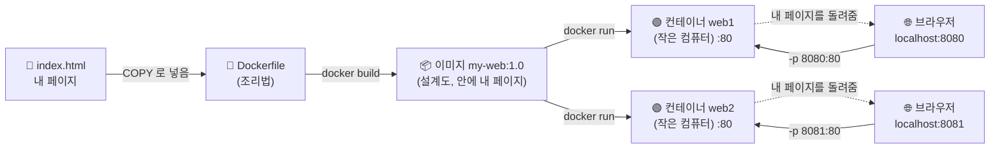
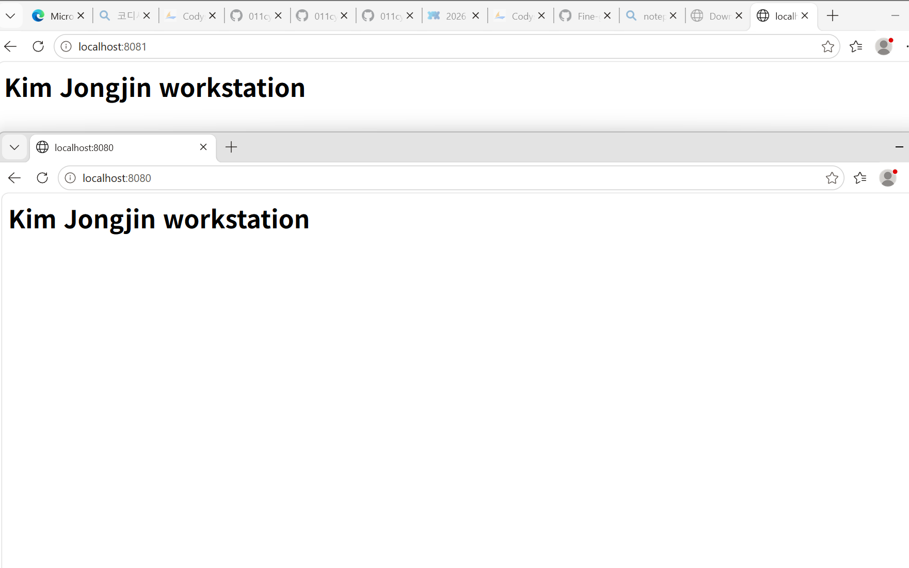

<div align="center">

# 🛠️ E1-1 개발 워크스테이션 구축
### 내 컴퓨터에 개발자용 '작업실' 꾸미기

코디세이 올인원 1기 · Github과 Codyssey를 연동하기 위해 만들어진 Repository입니다.


</div>

---

## 📌 바로 가기

<div align="center">

| 📋 [미션 대조표](e1-1-workstation/docs/mission-check.md) | 💡 [이걸 왜 하나](e1-1-workstation/docs/why-this-matters.md) | 🔍 [출력 읽는 법](e1-1-workstation/docs/reading-outputs.md) | 🖥️ [터미널 로그](e1-1-workstation/logs/terminal.md) | 📝 [내 명령어 노트](e1-1-workstation/docs/my-notes.md) |
|:---:|:---:|:---:|:---:|:---:|
| 요구사항 ↔ 내가 한 것 | AI 와 무슨 관계인지 | 화면 출력 해석 | 친 명령과 출력 전부 | 내 메모 + 💬 코멘트 |

**목차** — [1. 개요](#1-개요) · [2. 실행 환경](#2-실행-환경) · [3. 한 일 확인표](#3-한-일-확인표) · [4. 검증](#4-검증-방법과-결과) · [5. 내 이미지 만들기](#5-내-이미지-만들기) · [6. 내 말로 정리](#6-내-말로-정리) · [7. 막혔던 일과 푼 방법](#7-막혔던-일과-푼-방법) · [8. 보안](#8-보안) · [9. 느낀점](#9-느낀점)

</div>

---

## 1. 개요

> **"내 컴퓨터에서만 되는" 문제를 줄이려고, 누가 써도 같은 방식으로 실행되는 작업실을 직접 꾸몄다.**

| 영역 | 한 일 |
|---|---|
| ⌨️ **터미널** | 폴더·파일을 만들고 옮기고, 권한을 바꿨다 |
| 🐳 **Docker** | 컨테이너를 켜고 끄고, Dockerfile 로 내 웹 서버 이미지를 만들었다. 포트·바인드 마운트·볼륨도 확인했다 |
| 🌿 **Git/GitHub** | 내 이름표를 설정하고, 결과를 이 저장소에 올렸다 |



> 브라우저에 뜬 **"Kim Jongjin workstation"** 은 Dockerfile 의 `COPY` 줄로 이미지 안에 넣은 내 `index.html` 이다. 브라우저 → 포트 → 컨테이너 → 이미지 → Dockerfile 로 거슬러 올라가면 이어져 있다.

## 2. 실행 환경

| 항목 | 내용 | 증거 |
|---|---|---|
| 💻 OS | Windows 11 Pro 26H2 (OS 빌드 26300.9711), 교육장 공용 PC | [winver](e1-1-workstation/screenshots/winver.png) |
| ⌨️ 셸 | Git Bash (MINGW64 UCRT64), 명령 프롬프트(cmd) | — |
| 🐳 Docker | `Docker version 29.9.2, build a82e528` · Desktop 4.97.0 (WSL2, `linux/x86_64`) | [로그 3](e1-1-workstation/logs/terminal.md#3-docker-점검과-운영) |
| 🌿 Git | `git version 2.56.0.windows.4` | [로그 9](e1-1-workstation/logs/terminal.md#9-git-설정) |

## 3. 한 일 확인표

| | 항목 | 내용 |
|:---:|---|---|
| ✅ | 터미널 | `pwd` `ls -la` `cd` `mkdir` `touch` `echo` `cat` `cp` `mv` `rm` |
| ✅ | 권한 | 파일 644 → 600, 폴더 755 → 700 → 755 전/후 비교 |
| ✅ | Docker 점검 | `docker --version`, `docker info` |
| ✅ | Docker 운영 | `pull` `images` `run` `ps` `ps -a` `logs` `stats` `stop` `rm` |
| ✅ | 첫 컨테이너 | `hello-world` 실행, `ubuntu` 안에서 명령 실행 |
| ✅ | attach / exec | 나온 뒤 컨테이너 상태 차이 관찰 |
| ✅ | 내 이미지 | Dockerfile 로 `my-web:1.0` 빌드 |
| ✅ | 포트 매핑 | 8080, 8081 두 개 접속 |
| ✅ | 바인드 마운트 | 호스트 파일 수정이 컨테이너에 바로 반영 |
| ✅ | 볼륨 | 컨테이너를 지워도 데이터 유지 |
| ✅ | Git 설정 | `user.name`, `user.email`, `init.defaultBranch main` |
| ✅ | VS Code | GitHub 로그인 `011cyon-dot (GitHub)` — [사진](e1-1-workstation/screenshots/vscode-github.jpg) |

## 4. 검증 방법과 결과

| 항목 | 확인한 명령 | 결과 | 증거 |
|---|---|---|---|
| 숨김 파일 | `ls` vs `ls -la` | `.secret` 은 `ls -la` 에서만 보임 | [로그 1](e1-1-workstation/logs/terminal.md#1-터미널-조작) |
| 파일 권한 | `chmod 600` 전후 `ls -l` | `-rw-r--r--` → `-rw-------` | [로그 2](e1-1-workstation/logs/terminal.md#2-권한) |
| 폴더 권한 | `chmod 700` / `755` 전후 `ls -ld` | `drwxr-xr-x` → `drwx------` → `drwxr-xr-x` | [로그 2](e1-1-workstation/logs/terminal.md#2-권한) |
| Docker 동작 | `docker run hello-world` | `Hello from Docker!` | [로그 3](e1-1-workstation/logs/terminal.md#3-docker-점검과-운영) |
| 컨테이너 상태 | `stop` 뒤 `ps` / `ps -a` | `ps` 에서 사라지고 `ps -a` 에 `Exited (0)` | [로그 3](e1-1-workstation/logs/terminal.md#3-docker-점검과-운영) |
| attach / exec | 들어갔다 `exit` 뒤 `ps -a` | exec 뒤 `Up`, attach 뒤 `Exited (0)` | [로그 4](e1-1-workstation/logs/terminal.md#4-attach-와-exec) |
| 내 이미지 | `docker build -t my-web:1.0 .` | `docker images` 에 `my-web:1.0` | [Dockerfile](e1-1-workstation/web/Dockerfile) |
| 포트 매핑 | `curl localhost:8080`, `:8081` | 둘 다 `Kim Jongjin workstation` | [로그 6](e1-1-workstation/logs/terminal.md#6-포트-매핑) |
| 바인드 마운트 | 파일 수정 전후 `curl :8082` | `before` → `after - changed on host` | [로그 7](e1-1-workstation/logs/terminal.md#7-바인드-마운트) |
| 볼륨 | 쓰기 → 삭제 → 새 컨테이너에서 읽기 | `saved-in-volume` 유지 | [로그 8](e1-1-workstation/logs/terminal.md#8-볼륨) |
| Git 설정 | `git config --list` | `init.defaultbranch=main` 등 | [로그 9](e1-1-workstation/logs/terminal.md#9-git-설정) |

<p align="center">
  <br>
  <sub>같은 이미지 하나로 띄운 두 컨테이너 — 8080, 8081 모두 같은 페이지</sub>
</p>

## 5. 내 이미지 만들기

| 바탕 이미지 | 내가 바꾼 것 |
|---|---|
| `nginx:alpine` — 가벼운 웹 서버, 정적 페이지 한 장에 알맞음 | nginx 기본 홈페이지를 내 페이지(`index.html`)로 교체 |

```dockerfile
FROM nginx:alpine
COPY index.html /usr/share/nginx/html/index.html
```

```bash
cd e1-1-workstation/web
docker build -t my-web:1.0 .
docker run -d --name web1 -p 8080:80 my-web:1.0
curl http://localhost:8080        # <h1>Kim Jongjin workstation</h1>
```

> [!WARNING]
> `-p 8080:80` 은 이 PC의 모든 네트워크(`0.0.0.0`)에 문을 연다. 교육장처럼 같은 망을 쓰는 곳에서는 `-p 127.0.0.1:8080:80` 으로 내 PC에서만 열리게 하는 게 안전하다.

## 6. 내 말로 정리

| 질문 | 내 답 |
|---|---|
| **절대 vs 상대 경로** | 절대는 꼭대기부터 다 적는다(`cd /c` 는 어디서든 C 드라이브). 상대는 지금 위치 기준(`cd workstation`) |
| **권한 644·755** | r=4, w=2, x=1 을 나·그룹·나머지 순서로 더한다. 644 `rw-r--r--` 나만 쓰기 / 755 `rwxr-xr-x` 남은 보기·들어가기 |
| **포트 매핑이 필요한 이유** | 컨테이너는 막혀 있어서 `-p 8080:80` 으로 내 8080번과 컨테이너 80번을 이어 줘야 들어간다 |
| **볼륨 vs 바인드 마운트** | 볼륨은 Docker 가 따로 보관 → 컨테이너를 지워도 남음. 바인드 마운트는 내 폴더를 그대로 연결 |
| **Git vs GitHub** | Git 은 내 컴퓨터의 변경 기록(commit). GitHub 은 그 기록을 올려 두는 인터넷 저장소(push/pull) |

> [!TIP]
> 화면에 나온 출력을 한 줄씩 읽는 법은 **[출력 읽는 법](e1-1-workstation/docs/reading-outputs.md)** 에 따로 정리했다.

## 7. 막혔던 일과 푼 방법

| # | 문제 | 원인 | 해결 |
|:---:|---|---|---|
| ① | PowerShell 에서 `cd ~/...`, `touch` 가 안 됨 | 줄 앞이 `PS C:\>` — PowerShell 은 리눅스 셸이 아님 | `& "C:\Program Files\Git\bin\bash.exe"` 로 Git Bash 진입 → 줄 앞이 `$` |
| ② | `pwd` → `command not found` | 한글 입력기가 켜져 깨진 글자(`\343\205pwd`)가 섞임 | 영어 입력으로 바꾸고 폴더 이름도 영어로 |
| ③ | `mkdir -P` → `unknown option -- P` | 리눅스 옵션은 대소문자 구분 | `mkdir -p` 로 다시, 잘못 생긴 파일은 `mv` 로 옮김 |
| ④ | Git Bash 에서 `chmod` 해도 그대로 | 윈도우 파일 시스템(NTFS)은 리눅스 권한을 안 씀 | `docker run -it --rm ubuntu bash` 진짜 리눅스 안에서 다시 |
| ⑤ | 설치 직후 `docker: command not found` | 설치 전에 연 터미널이라 PATH 가 옛날 것 | 터미널을 새로 열기 |
| ⑥ | `docker rm web` → `container is running` | 켜진 컨테이너는 못 지움 | `docker stop web` 후 `rm` |
| ⑦ | cmd 에서 `cd /c/...` 실패, Git Bash 에서 `\c\...` 실패 | 셸마다 경로 표기가 다름 (`C:\` vs `/c/`) | 셸에 맞게 쓰고, Git Bash 의 `docker -v` 에는 `MSYS_NO_PATHCONV=1` |

## 8. 보안

- 🔒 토큰·비밀번호·인증 코드는 이 문서에 넣지 않았다.
- 🧹 공용 PC라 실습 뒤 GitHub·VS Code 로그아웃과 Windows 자격 증명 삭제를 한다.

## 9. 느낀점

> 처음엔 AI 과정에서 왜 터미널과 Docker 부터 하나 싶었다. 솔직히 실습 중에는 **컨테이너가 뭔지도 모르고 따라 쳤다.** 명령이 성공한 것과 내가 이해한 것은 달랐다.
>
> 끝나고 하나씩 물어 보니 AI 프로그램도 결국 어느 컴퓨터에서든 똑같이 돌아가야 쓸 수 있고, 그 바탕이 컨테이너·포트·볼륨·Git 이었다.

👉 모르고 쓴 말을 내 말로 다시 정리한 것과 AI 와의 연결 → **[why-this-matters.md](e1-1-workstation/docs/why-this-matters.md)**

---

## 📎 (지난 실습) 출석부 attend.py — 11-02

날짜와 이름을 넣으면 출석이 쌓이고 목록을 볼 수 있는 프로그램. 파일 하나, 외부 라이브러리 없음.

```bash
python attend.py                      # 메뉴
python attend.py add 김종진            # 오늘 출석
python attend.py add 김종진 2026-11-02 # 날짜 지정
python attend.py list [2026-11-02]    # 목록 (날짜별)
python attend.py count                # 사람별 횟수
```
맥은 `python3`. 기록은 `attendance.csv`(엑셀로 열림) — 이름이 들어가서 git 에는 올리지 않는다.

school run ok 11-02
home run ok 11-02
